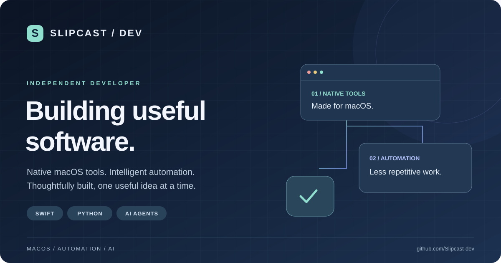
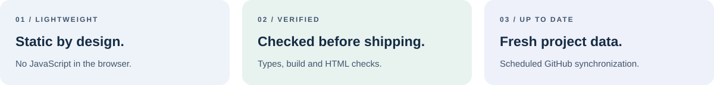

[](https://github.com/Slipcast-dev/Slipcast-dev.github.io/actions/workflows/deploy.yml)
[](https://astro.build/)
[](tsconfig.json)
[](src/pages/index.astro)
[](https://slipcast-dev.github.io)

Портфолио **Slipcast / Dev**: нативные macOS-инструменты, автоматизация и AI-агенты.
Одна статическая страница на Astro, чистый CSS и системные шрифты. Браузер посетителя не выполняет JavaScript и не обращается к GitHub API.



## Проекты

| Проект | Направление | Исходники и релизы |
| --- | --- | --- |
| Athena-Agent | Локальный macOS-агент, мониторинг, диагностика, MCP | [Код](https://github.com/Slipcast-dev/Athena-Agent) · [Релизы](https://github.com/Slipcast-dev/Athena-Agent/releases) |
| Ares-Agent | Локальный macOS-агент, файловая автоматизация, MCP | [Код](https://github.com/Slipcast-dev/Ares-Agent) · [Релизы](https://github.com/Slipcast-dev/Ares-Agent/releases) |
| translator-Koto | Переводчик для macOS, выделение текста, OCR, Apple Translation | [Код](https://github.com/Slipcast-dev/translator-Koto) · [Релизы](https://github.com/Slipcast-dev/translator-Koto/releases) |

Текущие версии, публичные описания и даты push хранятся в [снимке данных](src/data/projects.snapshot.json). Они не дублируются в этой таблице, чтобы README не отставал от релизов. Приватные проекты в публичную витрину не включаются.

## Локальный запуск

Требуется **Node.js 22.23.4 или новее**; рекомендуемая версия **24** указана в `.nvmrc`.

```bash
nvm use                       # если установлен nvm
npm ci                        # зависимости строго из package-lock.json
npm run dev                   # http://127.0.0.1:4321
```

Обычный запуск и сборка используют сохранённый снимок и не требуют токенов GitHub или доступа к API.

## Проверки и сборка

```bash
npm run check                 # проверка Astro и TypeScript
npm run build                 # статический сайт в dist/
npm test                      # регрессионные проверки после сборки
npm run validate              # check → build → test одной командой
npm run preview               # просмотр dist/ на http://127.0.0.1:4321
npm run astro -- preview stop # остановка preview-сервера Astro 7
```

Тесты проверяют отдельные ссылки на репозитории и релизы, отсутствие вложенных ссылок, защиту внешних ссылок, сортировку карточек, canonical, социальное PNG-превью, отсутствие клиентского JavaScript и контраст основных сочетаний текста и фона по WCAG AA. Это не заменяет полную проверку доступности в браузере.

## Обновление проектов

```bash
npm run sync:projects
npm run validate
```

Скрипт `scripts/sync-projects.mjs` обращается к публичному GitHub REST API:

- обрабатывает только явно перечисленные публичные проекты;
- получает описание и дату последнего push, сортирует карточки по этой дате;
- просматривает опубликованные релизы с пагинацией, включая prerelease;
- выбирает последний опубликованный релиз по `published_at`, скрывает кнопку, если релизов нет;
- оставляет названия витрины и тематические теги под редакционным контролем;
- заменяет JSON только после успешного получения всех данных; ошибка сети или API завершает команду с ненулевым кодом, прежний снимок сохраняется.

Без токена действуют анонимные лимиты GitHub API. Для ручного запуска при необходимости можно передать `GITHUB_TOKEN` через окружение. Токен не сохраняется в исходники; `.env` не загружается автоматически.

## Публикация и CI

[Workflow](.github/workflows/deploy.yml) проверяет pull request без публикации. Push в `main` запускает проверку типов, сборку, тесты и публикацию в GitHub Pages.

Дополнительно workflow запускается ежедневно в **06:17 UTC / 09:17 Минск** и вручную через **Actions → Deploy to GitHub Pages → Run workflow**. Эти запуски сначала обновляют публичные метаданные, затем проверяют и публикуют сайт. Расписание GitHub может выполняться с задержкой.

Автоматическое обновление меняет данные только внутри сборки: workflow **не делает commit/push**. Чтобы обновить снимок в локальном репозитории и истории Git, выполните `npm run sync:projects`, проверьте результат и сохраните изменение обычным коммитом. При сбое обновления новая версия не публикуется, предыдущий сайт остаётся доступным.

В настройках репозитория **Settings → Pages → Source** должен быть выбран **GitHub Actions**. Используется production-адрес `https://slipcast-dev.github.io` из `astro.config.mjs`; домен `slipcast.dev` не подключён. Если он будет подключён позже, сначала настройте DNS и домен в GitHub Pages, затем измените `site` и ожидаемые URL в тестах. Изменение `site` само по себе домен не подключает.

## Структура и оформление

```text
src/
  data/projects.ts              # интерфейс Project и импорт снимка
  data/projects.snapshot.json   # актуальные публичные метаданные
  layouts/Layout.astro          # HTML, canonical, Open Graph, Twitter Card
  pages/index.astro             # контент и карточки с отдельными ссылками
  styles/global.css             # палитра, сетка, адаптивность, фокус
scripts/
  sync-projects.mjs             # обновление снимка через GitHub API
  render-banner.mjs             # генерация PNG из SVG-баннера
tests/site.test.mjs              # проверки результата сборки и контраста
docs/assets/                    # редактируемые SVG-баннеры README
public/
  favicon.svg
  social-preview.png            # социальное превью 1200 × 630
```

Палитра настраивается через CSS-переменные в `:root`. Фон карточек чередуется через `:nth-child(odd)`; отдельного поля `highlighted` нет. Кнопка **Releases** — самостоятельная ссылка рядом с основной ссылкой карточки, доступная с клавиатуры.

Для обновления баннера отредактируйте `docs/assets/banner.svg`, затем выполните:

```bash
npm run banner
npm run validate
```

SVG используется в README, а сгенерированный PNG — в Open Graph и Twitter Card. Информационные панели находятся в `docs/assets/info.svg`. Изображения не зависят от внешнего генератора баннеров; небольшие статусные бейджи загружаются с GitHub и Shields.io.

Подробности изменений — в [CHANGELOG.md](CHANGELOG.md).
